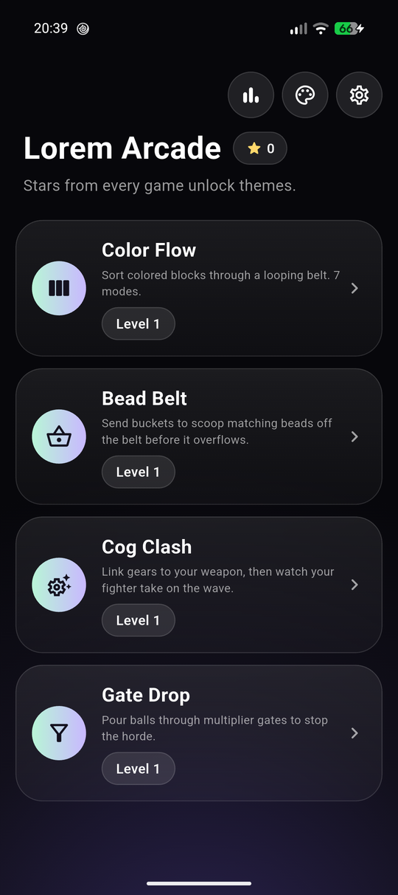
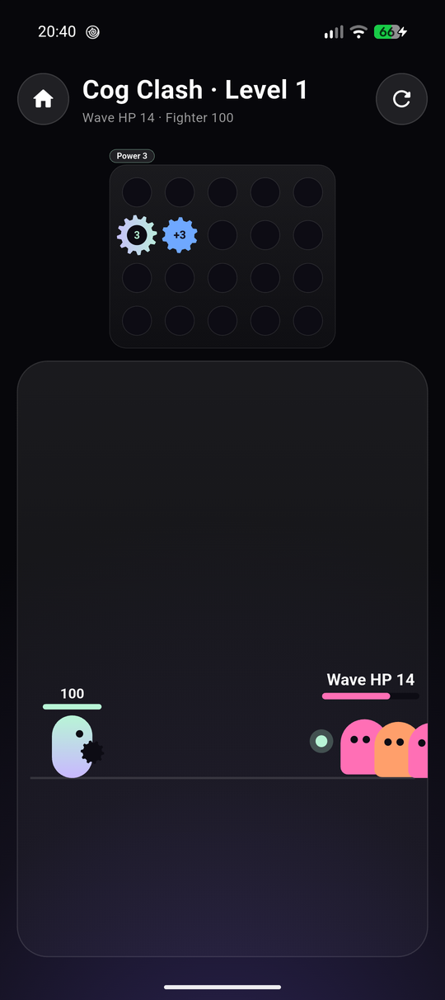
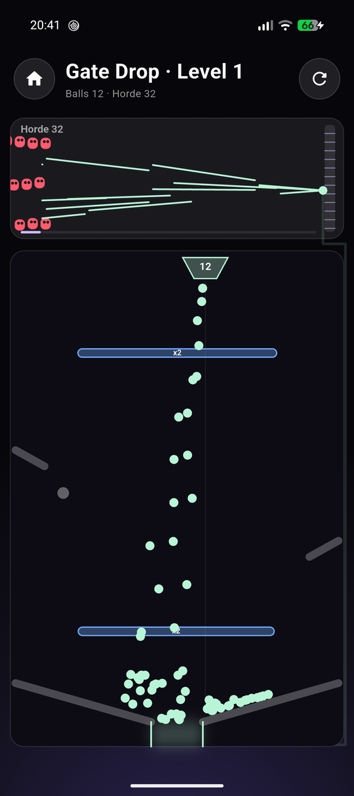
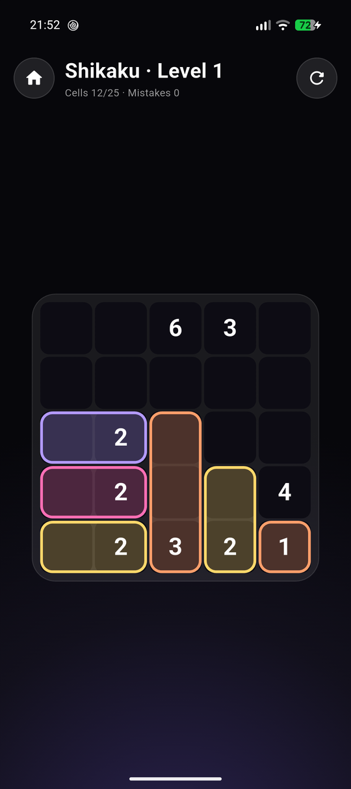
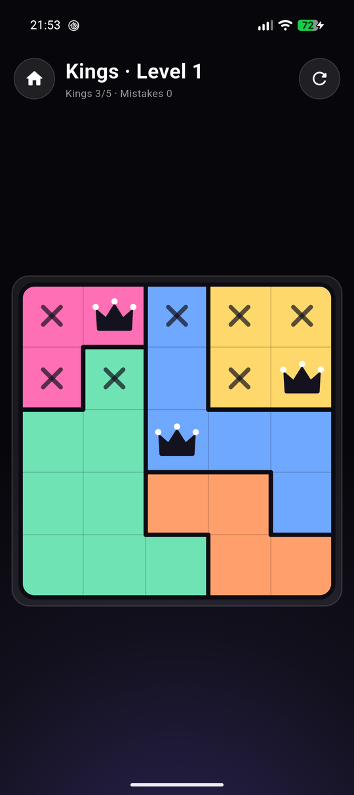

# Lorem Arcade

Six small puzzle and arcade games in one Android app, in one dark glass
style. Stars from every game add up and unlock color themes for all of them.

<p>
  
  
  
  
  
  
  
</p>

## Games

### Color Flow
Tubes of colored blocks around a looping belt. Tap a tube to send its top run
onto the belt; blocks drop into the tube that fits them best. Sort every tube.

Seven modes: **Levels**, **Move limit**, **Timed**, **Daily puzzle** (with a
streak), **Endless**, **Belt full** (the belt starts full) and **Rush** (new
blocks keep arriving; clear full tubes before the belt overflows). Later
levels add locked blocks, hidden blocks and wild rainbow blocks.

### Bead Belt
A belt full of colored beads. Tap a bucket to put it in a free dock; it
scoops up beads of its color until it is full and leaves. Clear the belt
before it jams.

### Cog Clash
Buy gears and place them on a grid so they link to your weapons while waves
of enemies walk in. Number gears add power, 2x and 3x gears multiply it, and
equal gears next to each other merge. Power changes the moment you place or
sell a gear, and defeated enemies pay coins for more. Beat 2 to 4 waves per
level, or play **Endless**: the waves never stop, and your score is the
number of waves you clear.

### Gate Drop
Hold and drag to pour balls from a cup through x2, x3 and x5 gates and past
lock bars. Every ball that reaches the pipe fires at the horde. Stop it
before it breaks through. Watch out for /2 traps, bounce off bumpers, send
balls back to the cup through refill gates and hit the small, fast x10
jackpot. Multiplies fill the fever meter for a few seconds of double
damage, and big bursts push the horde back. Every 5th level is a shielded
boss, every 7th a bonus level without a horde. Or play **Endless**: wave
after wave on new shafts, and your score is the number of waves you clear.

### Shikaku
A grid with numbered cells. Drag to draw rectangles so every rectangle holds
exactly one number and covers that many cells. Tap a rectangle to remove it.
Fill the whole grid; a rectangle that breaks the rules turns red and costs a
star.

### Kings
A square grid split into colored regions. Place one king in every row, every
column and every region, and no two kings may touch, not even diagonally.
Tap a cell to place a king, tap it again to take it off. Cells a king rules
out are crossed out on their own. A king that clashes turns red, and both a
clash and taking a king off cost a star.

## Features

- 1 to 3 stars per level in every level-based mode; stars unlock themes
  (Neon, Pastel, Mono + shapes) and there is a color-blind palette.
- Progress is saved per game and per mode; an unfinished Color Flow level is
  restored after the app is closed.
- Sound effects and haptics, both can be turned off.
- Pause when the app goes to the background, and a confirm before leaving a
  level in progress.
- Screen reader labels in the menus and in Color Flow, scalable text and
  large touch targets.
- Works offline. No ads, no tracking, no accounts.

## Install

Download the latest APK from the
[Releases](https://github.com/KobeBrandt/lorem-arcade/releases) page and open
it on your Android phone (you may need to allow installs from your browser or
file manager). Needs Android 7.0 (API 24) or newer.

## Build from source

Needs [Flutter](https://docs.flutter.dev/get-started/install) 3.47 or newer
and the Android SDK.

```bash
flutter pub get
flutter run
```

Run the tests and the analyzer:

```bash
flutter test
flutter analyze
```

Build a release APK:

```bash
flutter build apk --release
```

### Release signing

Release builds are signed with the key described in `android/key.properties`
(not in git). It holds `storeFile`, `storePassword`, `keyAlias` and
`keyPassword`. Without that file, release builds fall back to the debug key
and Gradle prints a warning; such a build must not be published.

## Project layout

| Path | What |
|---|---|
| `lib/game/` | Color Flow: board rules, level generator and solver, the Flame game |
| `lib/games/bead_belt/`, `cog_clash/`, `gate_drop/` | The other three games |
| `lib/arcade/` | Shared level screen and game catalog for the hub games |
| `lib/ui/` | Hub, Color Flow screens, stats, themes, settings, shared widgets |
| `lib/audio/` | Sound effects, synthesized in Dart (`tool/make_sounds.dart`) |
| `test/` | Unit, game and widget tests |

## License

Copyright (C) 2026 KBrandt.dev

This program is free software: you can redistribute it and/or modify it under
the terms of the GNU General Public License as published by the Free Software
Foundation, either version 3 of the License, or (at your option) any later
version.

This program is distributed in the hope that it will be useful, but WITHOUT
ANY WARRANTY; without even the implied warranty of MERCHANTABILITY or FITNESS
FOR A PARTICULAR PURPOSE. See the [LICENSE](LICENSE) file for details.
